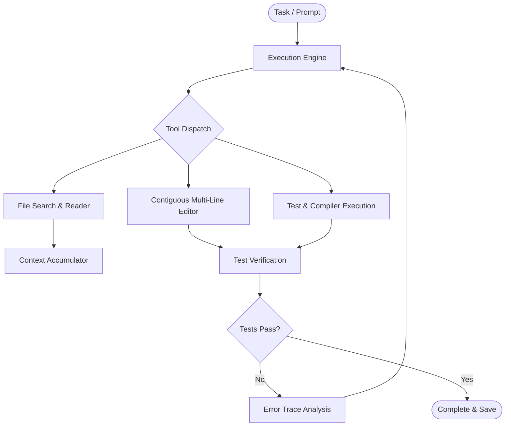

<div align="center">

  <h1>Qwen Code Interface</h1>

  <p><b>A lightweight desktop interface for local text generation and codebase refactoring</b></p>

  <p>
    A Python-based developer tool designed for local text generation, AST-aware refactoring, syntax checking, and automated test execution.
  </p>

  <p>
    <a href="https://www.python.org"></a>
    <a href="https://ollama.com"></a>
    <a href="LICENSE"></a>
  </p>

</div>

---

## Overview

**Qwen Code Interface** provides a developer interface for running local text generation models and automating multi-file editing and verification workflows.

Built with Python, it provides tools for directory navigation, regex editing, terminal execution, and test-driven validation.

---

## Key Features

- **Offline Local Execution** — Connects directly to local model runtimes via Ollama for on-device generation without external network dependencies.
- **AST Refactoring & Regex Editing** — Targeted file modification using contiguous multi-line regex match and syntax tree verification.
- **Automated Test Validation** — Automatically executes test commands against modified files and reports runtime traces.
- **Workspace Sandboxing** — Non-destructive directory isolation to protect untracked files during automated operations.

---

## Workflow



---

## Getting Started

### Prerequisites
- **Python**: `>= 3.10`
- **Ollama**: (For offline local execution) installed from [ollama.com](https://ollama.com)

### Quick Setup

1. **Clone the repository**:
   ```bash
   git clone https://github.com/CodeByPartho/Qwen-Coding-Agent.git
   cd Qwen-Coding-Agent
   ```

2. **Pull model weights**:
   ```bash
   ollama pull qwen2.5-coder:7b
   ```

3. **Install dependencies**:
   ```bash
   pip install -r requirements.txt
   ```

---

## License

This project is licensed under the **[MIT License](LICENSE)**.

---

<p align="center">Built by Partho</p>
