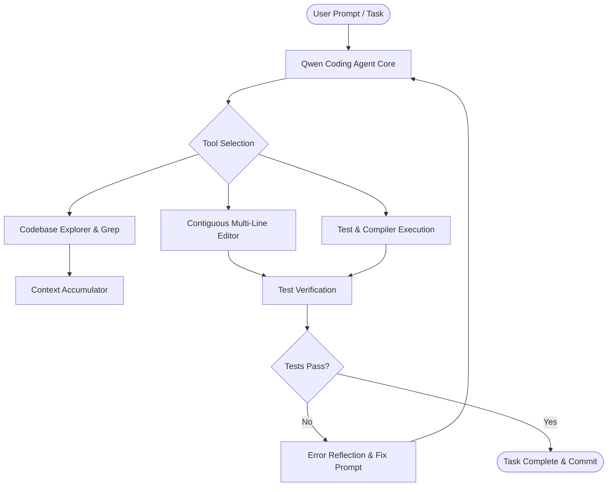

<div align="center">

  <h1>🤖 Qwen Coding Agent</h1>

  <p><b>Autonomous Coding & Repository Engineering Agent powered by Qwen 2.5 Coder</b></p>

  <p>
    An agentic software engineering harness designed for autonomous codebase exploration, AST-aware refactoring, automated bug resolution, and unit test synthesis powered by local and cloud Qwen 2.5 Coder neural models.
  </p>

  <p>
    <a href="https://github.com/QwenLM/Qwen2.5-Coder"></a>
    <a href="https://ollama.com"></a>
    <a href="https://www.python.org"></a>
    <a href="https://openrouter.ai"></a>
    <a href="LICENSE"></a>
  </p>

</div>

---

## 📖 Overview

**Qwen Coding Agent** is an agentic coding framework engineered around the state-of-the-art **Qwen 2.5 Coder** model family (ranging from 1.5B, 7B, 14B up to 32B parameters). 

It empowers developers to connect their terminal, IDE, or CI pipelines to an autonomous agent capable of recursive file tree exploration, syntax-validated code editing, dependency analysis, and automated test-driven repair cycles.

---

## 🚀 Key Features

- 🧠 **Optimized for Qwen 2.5 Coder** — Pre-configured system prompts and tool-calling schemas tailored to Qwen's specific ChatML tokenizer and function-calling tokens.
- 💻 **100% Offline Local Inference** — Seamless integration with **Ollama**, **vLLM**, and **llama.cpp** for private, on-device code generation without cloud API dependencies.
- 🌐 **Hybrid Cloud Gateway** — Optional fallback to high-throughput cloud endpoints via OpenRouter, Together AI, or Alibaba Cloud DashScope.
- 🛠️ **Tool-Calling Architecture** — Includes standardized tool definitions for file reading, contiguous multi-line regex editing, terminal execution, and ripgrep searches.
- 🔁 **Self-Healing Test Cycles** — Executes test commands automatically upon code modification, capturing stack traces to iteratively patch errors until green.
- 🛡️ **Safety Boundaries** — Configurable workspace sandboxing and non-destructive git branch isolation.

---

## 🏗️ Agent Workflow



---

## 🛠️ Supported Models

| Tier | Recommended Model | Best Use Case | RAM / VRAM Required |
| :--- | :--- | :--- | :--- |
| **Lightweight** | `qwen2.5-coder:1.5b` | Quick inline autocompletion & syntax checking | ~2 GB |
| **Balanced** | `qwen2.5-coder:7b` | General refactoring, bug fixes & unit tests | ~6 GB |
| **Flagship Local** | `qwen2.5-coder:14b` | Complex architecture & multi-file reasoning | ~12 GB |
| **Frontier Local** | `qwen2.5-coder:32b` | Full project synthesis & deep algorithmic debugging | ~24 GB |

---

## 💻 Getting Started

### Prerequisites
- **Python**: `>= 3.10`
- **Ollama**: (For offline local execution) installed from [ollama.com](https://ollama.com)

### Quick Setup

1. **Clone the repository**:
   ```bash
   git clone https://github.com/CodeByPartho/Qwen-Coding-Agent.git
   cd Qwen-Coding-Agent
   ```

2. **Pull the Qwen 2.5 Coder model**:
   ```bash
   # Pull your preferred model size
   ollama pull qwen2.5-coder:7b
   ```

3. **Configure environment (Optional Cloud Mode)**:
   ```bash
   export OPENROUTER_API_KEY="your_api_key_here"
   export MODEL_NAME="qwen/qwen-2.5-coder-32b-instruct"
   ```

---

## 📄 License

This project is licensed under the **[MIT License](LICENSE)**.

---

<p align="center">Made with ❤️ by Partho</p>
